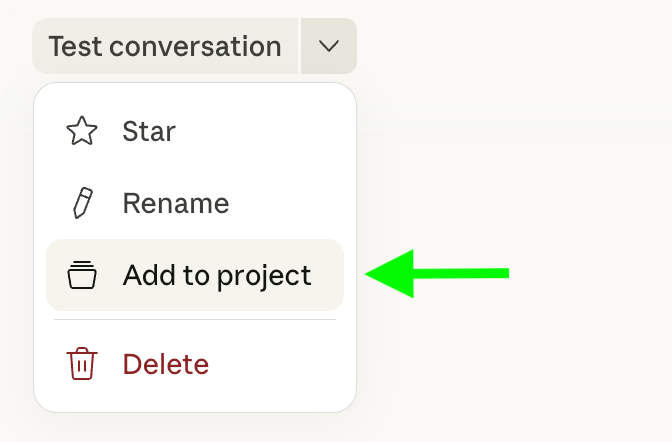
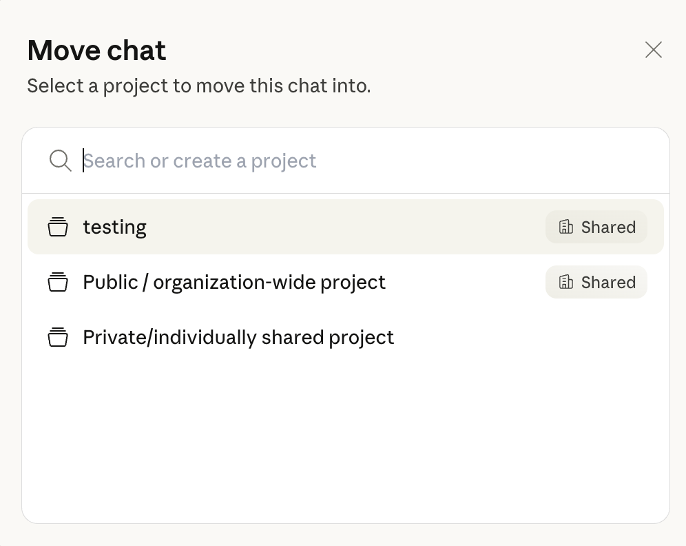

# Preparar a comissão e reutilizar a sua base

SIMULAÇÃO — cenário e identidade visual fictícios. CNPSM · 19 outubro 2026 · apoio às missões M01–M03.

Na M01, preparam o projeto da comissão. Na M02, usam-no para responder ao email da Inês e produzir o convite. Na M03, trabalham a passagem a outro colega. O projeto organiza referências; a equipa continua responsável por conferir os resultados e aprovar documentos.

## M01 — criar o projeto da comissão

1. Descarreguem o **briefing da comissão** na M01. Abram **Projects**, escolham **+ New Project** e deem-lhe o nome «Comissão Organizadora — Encontro 2027».
2. Adicionem o briefing ao conhecimento do projeto, pelo botão **+**. O nome e a descrição do projeto não substituem este contexto.
3. Numa conversa do projeto, peçam instruções de trabalho e um guia de comunicação e identidade visual a partir do briefing. Revejam os dois resultados.
4. Em **Set project instructions**, guardem as instruções revistas. Guardem o guia «Comunicação e identidade visual v0.1 — proposta» num ficheiro e adicionem-no ao conhecimento do projeto. O briefing continua a ser a referência para os factos do encontro.
5. Abram um chat novo no projeto. Peçam que identifique as cores, o tom e uma pendência do encontro; confiram a resposta nas referências.

[Criação, instruções e conhecimento — documentação oficial Claude](https://support.claude.com/en/articles/9519177-how-can-i-create-and-manage-projects), verificada em 18 outubro 2026. A interface pode variar; não foi efetuado teste numa organização Team.

## O que pertence a cada parte

- **Instruções:** como trabalhar — seguir o guia, escrever em PT-PT, não inventar factos e pedir revisão.
- **Guia visual e de comunicação:** cores com códigos, fonte, hierarquia, estrutura dos documentos, tom e um pequeno exemplo com campos variáveis.
- **Briefing do encontro:** objetivo, público, data, local, responsabilidades, orçamento e pendências.

A M01 oferece uma proposta visual suficiente: azul-escuro #17384B, verde-petróleo #006F73, fundo branco #FFFFFF e Arial. Podem manter ou ajustar essa proposta. Não é identidade institucional aprovada. Não é preciso desenhar um logótipo ou uma marca completa.

## M02 — chega o email da Inês

Abram um chat no projeto e acrescentem o email da missão. Peçam o convite com as regras e o guia já disponíveis. Confiram os factos no email e abram uma versão com o design aplicado. O texto tem de continuar a funcionar como convite; notas e dúvidas internas ficam separadas.

Se a conta só produzir texto, apliquem a formatação num editor habitual. Uma descrição das cores não demonstra, por si só, que o documento ficou formatado corretamente. Confiram o ficheiro ou a versão efetivamente aberta.

Se a M01 estiver incompleta, usem a base mínima incluída na M02: a missão pode ser iniciada sem ficheiros ou entregas anteriores.

### Como aproveitar uma correção

Validem a alteração e atualizem a referência adequada: regra geral nas instruções; estrutura, cor ou fonte no guia; facto na fonte do encontro. Testem um novo pedido com a base revista. Não é necessário inventar uma alteração se as regras já funcionaram: expliquem uma que verificaram.

A biblioteca e a sua manutenção são convenções da equipa. Não presumam sincronização automática entre projetos nem correção retroativa de documentos já produzidos. Um responsável mantém a versão comum e distribui revisões a quem usa cópias.

## Partilha, quando existe Team

Se as permissões da organização o permitirem, partilhem o projeto com o colega. **Can view** permite consultar a base e criar chats; **Can edit** permite alterar instruções, conhecimento e acessos. Os chats não ficam todos visíveis por partilhar o projeto. «Public» refere-se à organização.

[Visibilidade e permissões — documentação oficial Claude](https://support.claude.com/en/articles/9519189-manage-project-visibility-and-sharing), verificada em 18 outubro 2026. [Restrições da organização](https://support.claude.com/en/articles/9927533-control-project-sharing-for-your-organization).

## Sem Team ou sem Projetos

Um projeto pessoal permite organizar a vossa base. Sem Projetos, mantenham instruções, guia e contexto em três blocos numa conversa; copiem-nos para uma conversa nova quando precisarem de os reutilizar. Cada conta conserva a sua cópia e a equipa distribui a versão revista manualmente. Não partilhem credenciais.

Sem acesso à IA, façam os mesmos trabalhos em papel ou num editor e revejam com um colega. A apresentação visual pode ser aplicada no editor que já usam.

## Projeto por área, evento ou pessoa?

Escolham o âmbito pelo trabalho, contexto e acessos necessários. Uma área serve tarefas recorrentes; um evento tem objetivo, prazo e documentos próprios; um espaço pessoal serve trabalho individual. Nesta formação, o projeto é da comissão que prepara este encontro. As regras gerais podem ser reaproveitadas noutros contextos, mantendo os factos específicos separados. Esta organização é uma proposta pedagógica, não uma hierarquia obrigatória da plataforma.

Uma base comum pode incluir modelos autorizados de ata, convite, ofício e relatório, orientações de identidade visual e contactos institucionais relevantes. Carreguem apenas o que existe, é autorizado e ajuda a tarefa. Logótipos e composição final continuam a precisar de revisão visual.

## M03 — passar uma referência de trabalho

A passagem identifica tarefa, factos, documento acessível e estado, pendências e próximo passo. A equipa escolhe um local comum e uma pessoa para integrar alterações. O nome «final» não prova aprovação. No caso de Rui, a versão do convite está ausente: reconhecer a falta e pedir recuperação é preferível a inventar uma versão oficial.

## Imagens oficiais de consulta — mover uma conversa

Passo opcional: a documentação mostra **Add to project** no menu da conversa e depois a escolha do destino. Estas capturas ilustram organização de chats; não comprovam configuração de partilha Team. [Fonte oficial e instruções](https://support.claude.com/en/articles/9519177-how-can-i-create-and-manage-projects#h_aebd2b696f).

Captura publicada pela Anthropic, recolhida em 17 outubro 2026. Não representa uma conta da CNPSM.

Mesma fonte e data. Para criar o projeto e adicionar referências, usem as secções oficiais ligadas no início deste guia.
